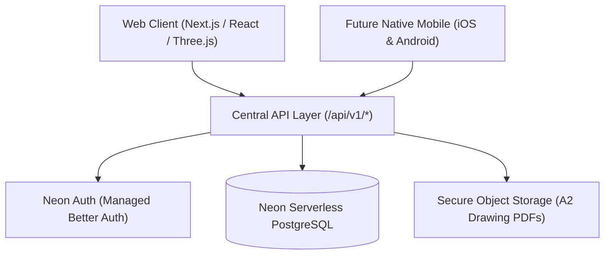

# System Architecture — The ArchEd

## 1. Architectural Overview
The ArchEd is constructed as a modern, decoupled, multi-tiered educational technology architecture designed for web, tablet, and cross-platform native mobile clients (iOS / Android).

## 2. Core Subsystems
1. **Presentation Tier (Next.js App Router)**:
   - High-performance Server Components (RSC) and Client Components for interactivity.
   - Zero-shadow, zero-emoji architectural design system with Tailwind CSS and Lucide React.
   - Three.js WebGL rendering engine for the Archiverse virtual environment.
2. **Identity & Access Tier (Neon Auth)**:
   - Managed Better Auth running inside the `neon_auth` schema on Neon PostgreSQL.
   - Strict server-side RBAC: `guest`, `student`, `jury`, `admin`.
3. **Data Tier (Neon PostgreSQL + Drizzle ORM)**:
   - Normalized relational data modeling with foreign key constraints, triggers, and indices.
   - Binary isolation: large A2 drawing portfolios (PDFs) and 3D assets stored in cloud object storage; only URLs and metadata stored in PostgreSQL.
4. **API Gateway Tier (`/api/v1/`)**:
   - Versioned REST endpoints serving both the web client and future mobile clients.
   - Input validation with Zod schemas.
