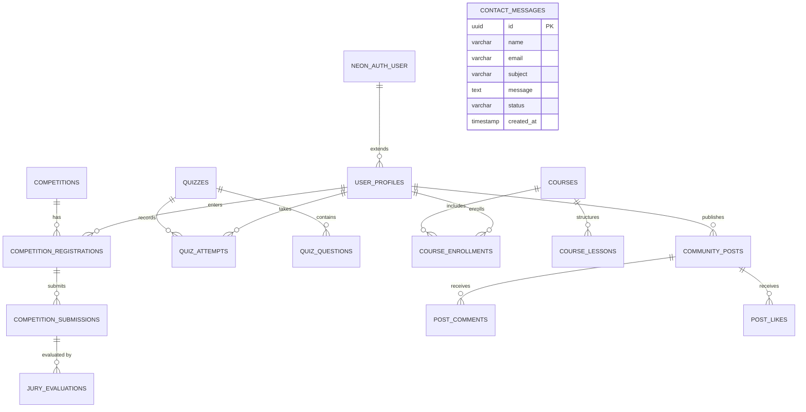

# Database Schema Specification — The ArchEd

## 1. Database Engine & Schema Strategy
- **Engine**: Neon Serverless PostgreSQL.
- **ORM**: Drizzle ORM with TypeScript schema definitions.
- **Identity Isolation**: Neon Auth manages tables under `neon_auth.*` (`user`, `session`, `account`, `verification`). The application database resides in the public schema and references `neon_auth.user.id` as foreign keys without duplicating credentials or password hashes.

## 2. Relational Entities
### 2.1 User Profiles & Roles (`user_profiles`)
- `id`: UUID (PK)
- `user_id`: VARCHAR (FK to `neon_auth.user.id`, UNIQUE)
- `display_name`: VARCHAR(255)
- `email`: VARCHAR(255)
- `role`: ENUM (`guest`, `student`, `jury`, `admin`) DEFAULT `student`
- `institution`: VARCHAR(255)
- `year_of_study`: VARCHAR(50)
- `portfolio_bio`: TEXT
- `avatar_url`: TEXT
- `created_at`: TIMESTAMPTZ

### 2.2 Competitions (`competitions`)
- `id`: UUID (PK)
- `title`: VARCHAR(255) (e.g. "Public Toilets for the Public Competition")
- `slug`: VARCHAR(255) UNIQUE
- `brief`: TEXT
- `description`: TEXT
- `status`: ENUM (`draft`, `upcoming`, `active`, `evaluation`, `completed`)
- `early_bird_deadline`: TIMESTAMPTZ
- `standard_deadline`: TIMESTAMPTZ
- `late_deadline`: TIMESTAMPTZ
- `submission_deadline`: TIMESTAMPTZ
- `jury_reveal_date`: TIMESTAMPTZ
- `result_declaration_date`: TIMESTAMPTZ
- `early_fee_inr`: INTEGER
- `standard_fee_inr`: INTEGER
- `late_fee_inr`: INTEGER
- `first_prize`: VARCHAR(100) (e.g. "Rs. 1,00,000")
- `second_prize`: VARCHAR(100) (e.g. "Rs. 50,000")
- `third_prize`: VARCHAR(100) (e.g. "Rs. 30,000")
- `honorable_mentions`: VARCHAR(100) (e.g. "10 Entries x Rs. 2,000")
- `banner_image_url`: TEXT
- `created_at`: TIMESTAMPTZ

### 2.3 Registrations & Submissions (`competition_registrations`, `competition_submissions`)
- Registration stores participant ID, team members, payment status (`pending`, `completed`, `refunded`), and registration code.
- Submission stores A2 drawings metadata (3 required drawing sheets: Plans, Elevations, Sections), consolidated PDF softcopy URL, design statement, project title, and anonymous jury code.

### 2.4 Jury Evaluations (`jury_evaluations`)
- `id`: UUID (PK)
- `submission_id`: UUID (FK)
- `jury_user_id`: VARCHAR (FK to `neon_auth.user.id`)
- `concept_score`: INTEGER (1-10)
- `sustainability_score`: INTEGER (1-10)
- `functionality_score`: INTEGER (1-10)
- `technical_drafting_score`: INTEGER (1-10)
- `total_score`: INTEGER
- `critique`: TEXT
- `evaluated_at`: TIMESTAMPTZ

### 2.5 Quizzes & Assessments (`quizzes`, `quiz_questions`, `quiz_attempts`)
- Timed assessment engine with dynamic DOM interaction, question weights, server-side grading, and real-time leaderboards.

### 2.6 Courses & Modules (`courses`, `course_lessons`, `course_enrollments`)
- Distance discovery platform with syllabus hierarchy, video lessons, and completion certificates.

### 2.7 Community Social Interface (`community_posts`, `post_comments`, `post_likes`)
- Architectural portfolio feed, design critiques, project showcases, and study groups.

### 2.8 Contact & Inquiries (`contact_messages`)
- Inquiries from `/contact.html` with asynchronous feedback.
